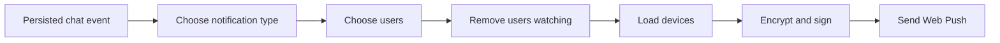

# Event-to-delivery pipeline

Remote creates notifications from persisted chat events, not directly from a
single interactive request. This covers interactive runs, application-started
turns, legacy scheduled runs, and recovery paths.

## Event classification

| Persisted event | Result |
| --- | --- |
| `AskUserQuestion` starts | Urgent question notification |
| `interaction_request` with `status=user_input` | Urgent question notification, including Codex and MiniMax |
| Interactive `complete` | Turn-finished notification |
| Interactive `error` | Run-failed notification |
| Application `complete` or `error` (`applicationId` present) | Application result notification with neutral wording |
| Legacy scheduled `complete` or `error` (`scheduledTaskId` present, no application origin) | Legacy scheduled-task notification |
| Other event | No notification |

When a run stops after `AskUserQuestion`, Remote suppresses the immediately
following terminal event. Otherwise that routine event would replace the more
important question notification in the tray.

A structured input request carries an entire question batch. Remote uses its
question text for a concise body, bounded to 200 characters and 240 UTF-8 bytes,
and falls back to "Open the chat to answer the question" when text is missing
or invalid. Questions marked secret are excluded from that body.
Duplicate turn/request or tool IDs share one alert; distinct batches may notify
again even when the chat has an older unread notification. A failed delivery
releases its own batch claim.

Matching `interaction_resolved` answers acknowledge the question notification
and resume the same run. Its later completion may notify normally. Other
request resolutions do not acknowledge a pending question, and a terminal
event following an unanswered question remains suppressed. Retryable errors
also preserve the pending question and do not replace its alert.

Plain-text question turns use the existing `<notification_summary>` block to
describe the input needed. They retain normal completion notification titles,
priority, and unread suppression. The notification instructions live in the
provisioned agent instruction files rather than being appended to individual
prompts. Runs without those instructions use the generic completion body when
the agent supplies no summary.
Plain-text questions do not activate `awaitingAnswer` because they have no
structured request/answer lifecycle.

Application identity does not imply scheduling. Scheduled Tasks and other
applications use the same generic notification type. Application-started user
events also do not reset unread suppression: automatic work is not evidence
that a person has read the chat.

## Audience

- A project chat notifies project members and administrators.
- A loose chat notifies every registered user.
- Stale project access entries are discarded unless the email still belongs to
  a registered user.
- Duplicate email addresses are removed.
- A user currently viewing the chat is removed before device lookup.

## Delivery

Remote serializes the notification once, then sends it to every stored device
for each remaining user. `webpush-go` performs payload encryption and VAPID
request construction. Remote supplies the safe HTTP client and interprets the
response.

| Result | Action |
| --- | --- |
| `2xx` | Record the successful send time |
| `404` or `410` | Delete the retired subscription |
| Other error | Log the failure and retain the subscription |

Question notifications use high urgency and a one-hour TTL. Other
notifications use normal urgency and a 12-hour TTL.

## Forked chats

Forking still copies the full visible event history into the new chat. Those
append operations are marked as historical replay, so persistence and
workspace updates run while notification side effects are suppressed.

## Current delivery gaps

- Devices are processed sequentially under one 30-second deadline.
- There is no bounded queue or retry for `429` and temporary `5xx` responses.
